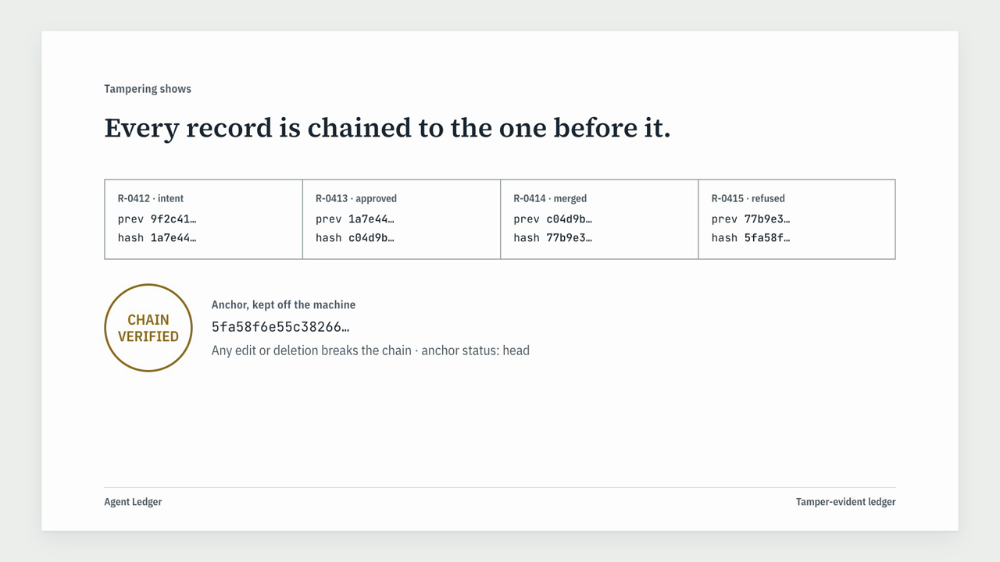

# Agent Ledger

Proof of what your AI agents did, and who approved it.

[](docs/media/agent-ledger-demo.mp4)

*Click the image to watch the demo (79 s). Final scenes use real output from a live home-lab run.*

## What it does

AI coding agents (Claude Code, Codex, MCP clients) now run commands, change infrastructure and touch production.
Agent Ledger sits between the agent and its tools:

1. **Checks every tool call** against a tool registry your team reviewed: read tools are allowed, reviewed write tools
   are allowed and recorded, risky tools need a named person, and anything unreviewed is denied.
2. **Asks a named approver in Slack** before a risky call runs. Timeouts, outages and unknown approvers all mean deny.
3. **Writes every decision first** to a tamper-evident, hash-chained ledger (local file or Postgres with append-only
   enforced by the database), then lets the tool run and records the outcome.
4. **Keeps secrets out of the ledger**: arguments not on a tool's allowlist are stored only as keyed HMAC fingerprints.
5. **Exports SOC 2 evidence** (HTML, PDF, CSV) mapped to CC6.1, CC7.2 and CC8.1, verified against an anchor kept off
   the machine, with the trust boundary stated on the cover.

## Two deployment modes

| Mode | How calls are collected | What the evidence proves |
|---|---|---|
| Local | Hooks inside Claude Code / Codex behind a fail-closed two-process watchdog | Visibility and best-effort gating; the machine owner could remove hooks, and the pack says so |
| Server | Agents connect to the Agent Ledger MCP proxy (TLS), which holds the tool credentials | Enforcement: the agent cannot reach the tool except through the proxy |

## Status

Pre-release, private. Server mode has run end to end in a hardened Kubernetes lab (Pod Security restricted,
default-deny NetworkPolicies, Kyverno admission policy, Falco runtime rules) with live Slack approvals.
A customer install guide and packaged images are the next slice.

### Verified in a live home lab (2026-10-07)

A clean redeploy on a 3-node kubeadm + Cilium cluster, following `docs/HOMELAB.md` step by step, with every control
tested both ways: the bad case must be refused and the good case must still work.

| Control | Proof |
|---|---|
| Pod Security `restricted` | A root Pod is rejected at admission (`runAsNonRoot != true`, `runAsUser=0`) |
| Kyverno admission policy | 9 crafted bad Pods rejected (unpinned image, missing digest, `NODE_OPTIONS`, `envFrom`, token automount, writable root, init container, projected token, spoofed `app` label) plus a debug-container patch on a live Pod; the real Pod templates admitted |
| Supply chain | Image built in-cluster with Kaniko and deployed by `sha256` digest; Trivy scan reviewed |
| Network isolation | Default deny; an attacker Pod in another namespace times out reaching the `everything` tool directly, so the only path to a tool is through the proxy |
| TLS only | HTTPS health check verified against the lab CA; plain HTTP gets no answer |
| Append-only ledger | `DELETE` as the application's own database role is refused |
| Falco runtime detection | A deliberate shell in the database Pod alerts; legitimate start-up shells do not |
| Real agent, real approvals | Claude Code through the proxy: read/write tools run and are recorded, a risky tool runs only after a Slack approval, an unreviewed tool is denied in Slack |
| Evidence | Chain verified against an anchor kept off the machine; SOC 2 pack generated from the day's records |
| Fail closed / no leaks | The image refuses to start without configuration; a sweep of the logs and evidence pack finds no key, token or password |

The run also caught a Falco rule that only failed on a real node (fixed in `deploy/falco/values.yaml`).

## Repository map

| Path | What |
|---|---|
| `src/` | hooks + watchdog, pipeline, policy, identity, ledger, approvals (Slack), front/upstream (MCP proxy), report, CLI, server |
| `deploy/` | Dockerfile, Kubernetes manifests (kustomize), SQL roles and triggers, Falco rules, Slack app manifest |
| `docs/spec.md` | Frozen framework spec (trust boundary in §3 and §7) |
| `docs/DEMO.md` | Local-mode demo script |
| `docs/HOMELAB.md` | Server-mode deployment runbook (home-lab Kubernetes) |
| `DESIGN.md` | Visual design system for the evidence pack and future UI |
| `docs/reviews/`, `docs/slices/` | Cross-review reports and per-slice interface pins |

## Development

```sh
npm ci
npm run check      # typecheck + unit + timing tests + build
```

Built by a two-engine agent team (Claude and Codex) under a build → independent cross-review → fix → verify loop;
every merge is approved by a human.
